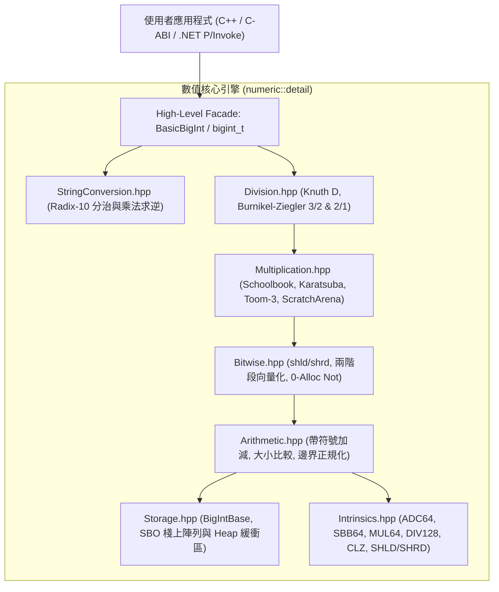

# CPP-BigInt 系統架構手冊 (ARCHITECTURE.md)

## 1. 系統架構概觀

`CPP-BigInt` 是一套現代化、零外部依賴、向下相容 C++11 至 C++23 的任意精度整數運算函式庫，同時提供純 C-ABI（可供 .NET P/Invoke、Python CTypes 或 Rust FFI 調用）。

系統採用模組化分層架構（Modular Layered Architecture）與雙層解耦（LLVM SmallVector Pattern），在兼顧極限執行效能的同時避免樣板程式碼膨脹。

---

## 2. 模組分層職責 (Separation of Concerns)

### 2.1 儲存與資料層 (Data Structure Layer)
- **`Storage.hpp` (`BigIntBase`, `BigIntStorage`)**:
  - 純資料載體：維護 limbs 指標 `m_data`、靜態棧上緩衝區 `m_inline_data`、長度 `m_size`、容量 `m_capacity` 與正負號 `m_sign`。
  - 專注於記憶體生命週期管理（SBO 判定、Heap 分配、擴容 `reserve`、縮容與自我別名防護），**嚴禁嵌入高階數值演算法**。
- **`BigInt.hpp` (`BasicBigInt<SboLimbs>`)**:
  - 面向使用者的強型別容器樣板，透過 SboLimbs 靜態配置自訂 SBO 容量（預設 256 bits = 4 limbs）。

### 2.2 核心硬體原語層 (Primitive Intrinsics Layer)
- **`Intrinsics.hpp` (`BigIntIntrinsics`)**:
  - 封裝 CPU 指令級原語（MSVC `<intrin.h>`、GCC/Clang 內建與 `unsigned __int128`）。
  - 提供 `adc64`, `sbb64`, `mul64_wide`, `div128_64`, `shld64`, `shrd64`, `addmul_1_raw`, `submul_1_raw`。
  - 全面支援 C++20 `std::is_constant_evaluated()` 常數求值。

### 2.3 邏輯演算法層 (Algorithm Logic Layer)
- **`Arithmetic.hpp`**: 無符號/帶符號加減法核心、規格化與大小比較。
- **`Bitwise.hpp`**: 雙字硬體位移、兩階段無分支 OR/XOR 向量化、零配置二補數 NOT。
- **`Multiplication.hpp`**:
  - `mul_schoolbook_raw`: 密集小數乘法（由 `addmul_1_raw` 驅動）。
  - `mul_karatsuba_raw`: $O(N^{1.585})$ Karatsuba 乘法（ScratchArena 零堆積配置）。
  - `mul_toom3_raw`: $O(N^{1.465})$ Toom-Cook 3-way 乘法（門檻 256 limbs）。
- **`Division.hpp`**:
  - `div_mod_core_knuth`: Knuth Algorithm D 原地長除法（由 `submul_1_raw` 驅動）。
  - `bz_div3by2_raw` / `bz_div2by1_raw`: Burnikel-Ziegler 分治除法（門檻 128 limbs，ScratchArena 零堆積配置）。
- **`StringConversion.hpp`**:
  - 快速 Radix-10 雙向轉換，結合乘法逆元（消除硬體除法）與分治除法。

---

## 3. 記憶體管理模型 (Memory Architecture)

1. **SBO 棧上陣列 (Stack Allocation)**:
   - 256 位元（或依樣板指定的 SboLimbs）內保證 0 次動態記憶體配置。
2. **無鎖 Bump Allocator (`ScratchArena`)**:
   - 專為遞迴演算法（Karatsuba、Toom-3、Burnikel-Ziegler）設計之線程局部暫存池。
   - 採用 RAII `ScratchArena::Scope` 自動回滾指標，消滅遞迴中的重複 `new/delete`。
