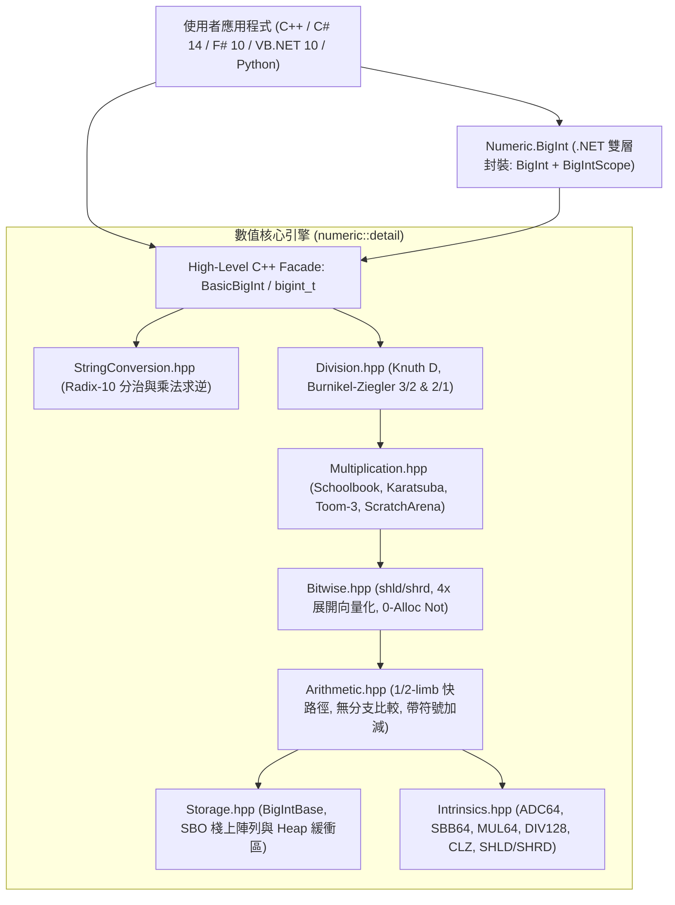

# CPP-BigInt 系統架構手冊 (ARCHITECTURE.md)

## 1. 系統架構概觀

`CPP-BigInt` 是一套現代化、零外部依賴、嚴格基於 **C++23** 標準建構的任意精度整數運算函式庫（支援 `std::span`、`std::expected`、Concepts、`<bit>` 與 RAII），同時提供純 C-ABI（`bigint_c.dll`）與官方 **.NET 跨語言託管封裝（`Numeric.BigInt`）**，供 C++、C# 14、F# 10、VB.NET 10、Python 與 Rust 調用。

系統採用模組化分層架構（Modular Layered Architecture）與雙層解耦（LLVM SmallVector Pattern），在兼顧極限執行效能的同時避免樣板程式碼膨脹。

---

## 2. 模組分層職責 (Separation of Concerns)

### 2.1 儲存與資料層 (Data Structure Layer)
- **`Storage.hpp` (`BigIntBase`)**:
  - 純資料載體（`static_assert(sizeof(BigIntBase) == 32)`）：維護 limbs 指標 `m_data`、衍生類別內聯區域指標 `m_inline_data`、長度 `m_size`、容量 `m_capacity`、SBO 上限 `m_sbo_capacity`、正負號 `m_sign` 與 SBO 旗標 `m_is_sbo`。
  - 透過二階段 `bind_inline(std::span<std::uint64_t>)` 繫結衍生類別 `std::array` 空間，以 `std::make_unique<std::uint64_t[]>` / `std::unique_ptr` RAII 管理堆積釋放，並提供標註 `NUMERIC_LIFETIMEBOUND` 的 `as_span()`、`capacity_span()` 與 `inline_span()` 視圖。
  - 專注於記憶體生命週期管理（SBO 判定、Heap 分配、擴容 `reserve`、縮容與自我別名防護），**嚴禁嵌入高階數值演算法**。
- **`BigInt.hpp` (`BasicBigInt<SboLimbs>`)**:
  - 面向使用者的強型別容器樣板，以 `std::array<std::uint64_t, ACTUAL_SBO>` 宣告內聯陣列（預設 256 bits = 4 limbs），並實作 `std::signed_integral` / `std::unsigned_integral` Concepts 建構約束、`explicit` 防誤轉語意、`BigIntError` 與 `std::expected` 非拋出 API。

### 2.2 核心硬體原語層 (Primitive Intrinsics Layer)
- **`Intrinsics.hpp` (`BigIntIntrinsics`)**:
  - 封裝 CPU 指令級原語（MSVC `<intrin.h>`、GCC/Clang 內建與 `unsigned __int128`）及 C++20/23 `<bit>` 標準原語（`std::countl_zero`, `std::bit_width`）。
  - 提供 `adc64`, `sbb64`, `mul64_wide`, `div128_64`, `shld64`, `shrd64`, `addmul_1_raw`, `submul_1_raw`。
  - 全面支援 `constexpr` 常數求值與編譯期可攜回退路徑。

### 2.3 邏輯演算法層 (Algorithm Logic Layer)
- **`Arithmetic.hpp` 與 `BigInt.hpp` 快路徑**：
  - 1-limb 與 2-limb 標量就地加減快路徑（`operator+=`, `operator-=`），結合硬體進借位大幅減少分支與正規化開銷。
  - 1/2/4-limb 無分支比較特化（`operator<`, `operator==`），由高位向低位單一不等比較。
- **`Bitwise.hpp`**:
  - `shld64` / `shrd64` 雙字硬體位移（移除迴圈內條件分支與小位數展開）。
  - `NUMERIC_RESTRICT` 4x 展開就地位元運算（`&=`, `|=`, `^=`），支援 SIMD 向量化並消除正數重配置開銷。
  - 零配置二補數 NOT。
- **`Multiplication.hpp`**:
  - `mul_schoolbook_raw`: 密集小數乘法（由 `addmul_1_raw` 驅動）。
  - `mul_karatsuba_raw` / `mul_block_karatsuba_raw`: $O(N^{1.585})$ Karatsuba 乘法（門檻 16 limbs，支援非對稱分塊，ScratchArena 零堆積配置）。
  - `mul_toom3_raw`: $O(N^{1.465})$ Toom-Cook 3-way 乘法（門檻 `TOOM3_THRESHOLD = 64` limbs / 4,096 bits）。
- **`Division.hpp`**:
  - `div_mod_core_knuth`: Knuth Algorithm D 原地長除法（由 `submul_1_raw` 驅動），亦為短商數除法提供直接快路徑與原地零配置除法/取模。
  - `bz_div3by2_raw` / `bz_div2by1_raw`: Burnikel-Ziegler 分治除法（門檻 `BZ_THRESHOLD = 32` limbs / 2,048 bits，以 `ScratchArena` 切片配置達成零堆積配置）。
- **`StringConversion.hpp`**:
  - 快速 Radix-10 雙向轉換，結合乘法逆元（消除硬體除法）與分治除法。

### 2.4 .NET 跨語言託管層 (`dotnet/src/Numeric.BigInt`)
- **Tier 1 (`BigInt` + `BigIntHandle`)**: 不可變物件封裝 `SafeHandleZeroOrMinusOneIsInvalid`，提供完整 CLS 相容運算子重載（含 VB.NET 專屬 `op_IntegerDivision` `\`）。
- **Tier 2 (`ref struct BigIntScope` & `BigIntSbo256`)**: 堆疊 SBO 緩衝區與無鎖暫存池，在 C# 熱點路徑達成嚴格 0 Bytes GC 配置。
- **Interop (`NativeMethods` & `NativeResolver`)**: 採用 `[LibraryImport]` 零封送開銷 P/Invoke 與跨平台自動 DLL 探查器。

---

## 3. 記憶體管理模型 (Memory Architecture)

1. **SBO 棧上陣列 (Stack Allocation)**:
   - 256 位元（或依樣板指定的 SboLimbs）內保證 0 次動態記憶體配置。
2. **無鎖分塊 Bump Allocator (`ScratchArena`)**:
   - 專為遞迴演算法（Karatsuba、Toom-3、Burnikel-Ziegler）設計之線程局部暫存池，採用指標穩定分塊機制（`std::unique_ptr<std::uint64_t[]>` 區塊管理）避免遞迴擴張導致指標懸置。
   - 採用 RAII `ScratchArena::Scope` 自動回滾指標，消滅遞迴中的重複 `new/delete`。
3. **編譯期安全強化與 Release 零開銷隔離**:
   - 全建置強制開啟高強度警告與錯誤視同設定（MSVC `/W4 /WX /permissive-`；GCC/Clang `-Wall -Wextra -Werror`）。
   - MSVC `/sdl` 堆疊自動零初始化僅限定於 Debug 組態（`$<$<CONFIG:Debug>:/sdl>`），避免在 Release 大型乘法與除法熱點強制對棧上陣列進行逐位元組零填充。
