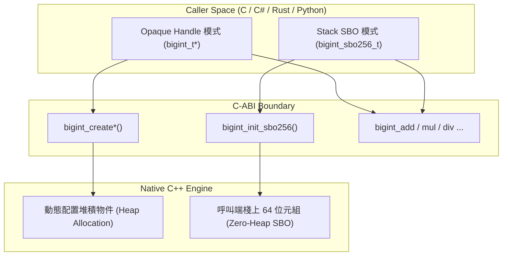

# C-ABI 跨語言介面參考手冊 (C-API Reference)

`CPP-BigInt` 提供一套標準、零依賴的 `extern "C"` 介面，支援純 C 語言專案直接呼叫，並提供無縫跨語言 Foreign Function Interface (FFI) 支援，包含 **Python (`ctypes` / `cffi`)**、**Rust (`bindgen` / `extern "C"`)**、**.NET / C# (`[DllImport]` / `[LibraryImport]`)** 及 **Go (`cgo`)**。

---

## 標頭檔與二進位庫

| 項目 | 檔案路徑 | 說明 |
| :--- | :--- | :--- |
| **模組標頭檔** | [`include/numeric/c_api.h`](../../include/numeric/c_api.h) | 原始碼開發目錄下的 C API 標頭檔。 |
| **發行單一標頭檔** | [`dist/bigint_c.h`](../../dist/bigint_c.h) | 隨發行版發布的純 C 單一標頭檔，可直接複製至第三方專案。 |
| **二進位共用庫** | `build/Release/bigint_c.dll` (`bigint_c.lib`) / `libbigint_c.so` | CMake 建置產生的動態連結函式庫。 |

---

## 核心設計架構：雙模態呼叫

`CPP-BigInt` 的 C-ABI 採用獨創的**雙模態支援**：



1. **不透明指標模式 (`bigint_t*`)**：
   - 適合絕大多數進階語言（如 Python、Go），透過 `bigint_create_*()` 於堆積配置物件，以 `bigint_destroy()` 釋放，能動態自適應任意大小的位元數。
2. **零配置棧上 SBO 模式 (`bigint_sbo256_t` / `bigint_sbo512_t`)**：
   - 專為極致低延遲環境（C、Rust、C#）設計。在呼叫端的呼叫棧（Stack）上宣告 64 位元組（4 limbs，256-bit）或 96 位元組（8 limbs，512-bit）之記憶體結構，直接呼叫 `bigint_init_sbo256()` 進行 placement-new。
   - **優勢**：在 256 位元（或 512 位元）以內運算享有無堆積配置（**0.00 ns 堆積開銷、0 Bytes GC 壓力**）。

---

## 狀態碼列舉 (`bigint_status_t`)

所有可能發生錯誤的 C-API 函式皆回傳 `bigint_status_t` 狀態碼，所有內部 C++ 異常皆被嚴格攔截並轉譯，絕不洩漏至 C-ABI 邊界之外：

| 狀態碼 | 數值 | 意義與說明 |
| :--- | :---: | :--- |
| `BIGINT_OK` | 0 | 運算成功 |
| `BIGINT_ERR_INVALID_ARG` | 1 | 傳入無效引數（如無效進位制、非數字字元） |
| `BIGINT_ERR_DIV_BY_ZERO` | 2 | 除以零錯誤（`/`、`%`、`div_rem`） |
| `BIGINT_ERR_BUFFER_TOO_SMALL` | 3 | 提供之字串輸出緩衝區過小 |
| `BIGINT_ERR_NULL_PTR` | 4 | 傳入空指標（Null Pointer） |
| `BIGINT_ERR_OUT_OF_MEMORY` | 5 | 記憶體配置失敗 |
| `BIGINT_ERR_OVERFLOW` | 6 | 轉型至 64 位元純量時數值溢位 |

---

## C-ABI 函式全覽表

### 1. 生命週期與配置 (Lifecycle)

```c
// 堆積 Handle 建立與釋放
bigint_t* bigint_create(void);
bigint_t* bigint_create_i64(int64_t val);
bigint_t* bigint_create_u64(uint64_t val);
bigint_t* bigint_create_str(const char* str, int base);
bigint_t* bigint_clone(const bigint_t* src);
void      bigint_destroy(bigint_t* b);

// 256-bit (64 bytes) 棧上 SBO 模式初始化與解構
bigint_t* bigint_init_sbo256(bigint_sbo256_t* storage, int64_t val);
bigint_t* bigint_init_sbo256_u64(bigint_sbo256_t* storage, uint64_t val);
bigint_t* bigint_init_sbo256_str(bigint_sbo256_t* storage, const char* str, int base);
void      bigint_destroy_sbo256(bigint_sbo256_t* storage);

// 512-bit (96 bytes) 棧上 SBO 模式初始化與解構
bigint_t* bigint_init_sbo512(bigint_sbo512_t* storage, int64_t val);
bigint_t* bigint_init_sbo512_u64(bigint_sbo512_t* storage, uint64_t val);
bigint_t* bigint_init_sbo512_str(bigint_sbo512_t* storage, const char* str, int base);
void      bigint_destroy_sbo512(bigint_sbo512_t* storage);
```

### 2. 賦值與修改 (Mutation)

```c
bigint_status_t bigint_assign(bigint_t* dst, const bigint_t* src);
bigint_status_t bigint_set_i64(bigint_t* dst, int64_t val);
bigint_status_t bigint_set_u64(bigint_t* dst, uint64_t val);
bigint_status_t bigint_set_str(bigint_t* dst, const char* str, int base); // base=0 自動偵測 0x/0b/0o 前綴
```

### 3. 基本算術運算 (Arithmetic)

```c
// 三位址運算 (out = a OP b，支援 out 與 a 或 b 記憶體重疊)
bigint_status_t bigint_add(bigint_t* out, const bigint_t* a, const bigint_t* b);
bigint_status_t bigint_sub(bigint_t* out, const bigint_t* a, const bigint_t* b);
bigint_status_t bigint_mul(bigint_t* out, const bigint_t* a, const bigint_t* b);
bigint_status_t bigint_div(bigint_t* out, const bigint_t* a, const bigint_t* b);
bigint_status_t bigint_mod(bigint_t* out, const bigint_t* a, const bigint_t* b);
bigint_status_t bigint_div_rem(bigint_t* q, bigint_t* r, const bigint_t* a, const bigint_t* b);
bigint_status_t bigint_neg(bigint_t* out, const bigint_t* a);
bigint_status_t bigint_abs(bigint_t* out, const bigint_t* a);

// 原地複合運算 (a = a OP b)
bigint_status_t bigint_add_inplace(bigint_t* a, const bigint_t* b);
bigint_status_t bigint_sub_inplace(bigint_t* a, const bigint_t* b);
bigint_status_t bigint_mul_inplace(bigint_t* a, const bigint_t* b);
bigint_status_t bigint_div_inplace(bigint_t* a, const bigint_t* b);
bigint_status_t bigint_mod_inplace(bigint_t* a, const bigint_t* b);
```

### 4. 位元運算與位移 (Bitwise & Shift)

```c
bigint_status_t bigint_and(bigint_t* out, const bigint_t* a, const bigint_t* b);
bigint_status_t bigint_or(bigint_t* out, const bigint_t* a, const bigint_t* b);
bigint_status_t bigint_xor(bigint_t* out, const bigint_t* a, const bigint_t* b);
bigint_status_t bigint_not(bigint_t* out, const bigint_t* a); // 二補數 bitwise NOT: -(a + 1)
bigint_status_t bigint_shl(bigint_t* out, const bigint_t* a, size_t shift);
bigint_status_t bigint_shr(bigint_t* out, const bigint_t* a, size_t shift);
```

### 5. 比較與檢測 (Comparison & Inspection)

```c
int    bigint_cmp(const bigint_t* a, const bigint_t* b);     // -1 (a < b), 0 (a == b), 1 (a > b)
int    bigint_cmp_i64(const bigint_t* a, int64_t b);        // -1, 0, 1
int    bigint_is_zero(const bigint_t* a);                   // 1 (為零), 0 (非零)
int    bigint_is_negative(const bigint_t* a);               // 1 (負數), 0 (非負)
int    bigint_sign(const bigint_t* a);                      // -1, 0, 1
size_t bigint_bit_length(const bigint_t* a);                // 有效位元長度
size_t bigint_limb_count(const bigint_t* a);                // 內部 64-bit limb 數量
int    bigint_is_sbo(const bigint_t* a);                    // 1 (處於棧上 SBO 模式), 0 (已配置堆積)
```

### 6. 高精度數論函式 (Mathematics)

```c
bigint_status_t bigint_pow(bigint_t* out, const bigint_t* base, uint32_t exp);
bigint_status_t bigint_gcd(bigint_t* out, const bigint_t* a, const bigint_t* b);
bigint_status_t bigint_lcm(bigint_t* out, const bigint_t* a, const bigint_t* b);
bigint_status_t bigint_isqrt(bigint_t* out, const bigint_t* a);
```

### 7. 型別轉換與格式化 (Conversions)

```c
int64_t  bigint_to_i64(const bigint_t* a, bigint_status_t* status);
uint64_t bigint_to_u64(const bigint_t* a, bigint_status_t* status);
size_t   bigint_to_str_len(const bigint_t* a, int base); // 回傳所需之緩衝區字元數（含結尾 '\0'）
bigint_status_t bigint_to_str(const bigint_t* a, char* buf, size_t buf_len, int base);
char*    bigint_to_str_alloc(const bigint_t* a, int base); // 內部 malloc，需呼叫 bigint_free_str
void     bigint_free_str(char* str);
```

---

## 跨語言整合範例代碼

### 1. 純 C (C99 / C11) 範例

```c
#include <numeric/c_api.h>
#include <stdio.h>

int main(void) {
    // 棧上 SBO 零堆積配置！
    bigint_sbo256_t sbo_a, sbo_b, sbo_res;
    bigint_t* a = bigint_init_sbo256(&sbo_a, 123456789);
    bigint_t* b = bigint_init_sbo256(&sbo_b, 987654321);
    bigint_t* res = bigint_init_sbo256(&sbo_res, 0);

    bigint_mul(res, a, b);

    char buf[64];
    bigint_to_str(res, buf, sizeof(buf), 10);
    printf("123456789 * 987654321 = %s\n", buf);

    bigint_destroy_sbo256(&sbo_res);
    bigint_destroy_sbo256(&sbo_b);
    bigint_destroy_sbo256(&sbo_a);
    return 0;
}
```

### 2. C# (.NET 10 P/Invoke) 範例

```csharp
using System;
using System.Runtime.InteropServices;

[StructLayout(LayoutKind.Sequential, Size = 64)]
public struct BigIntSbo256 {
    private ulong _d0, _d1, _d2, _d3, _d4, _d5, _d6, _d7;
}

public static class BigIntNative {
    [DllImport("bigint_c.dll", CallingConvention = CallingConvention.Cdecl)]
    public static extern IntPtr bigint_init_sbo256(ref BigIntSbo256 storage, long val);

    [DllImport("bigint_c.dll", CallingConvention = CallingConvention.Cdecl)]
    public static extern void bigint_destroy_sbo256(ref BigIntSbo256 storage);

    [DllImport("bigint_c.dll", CallingConvention = CallingConvention.Cdecl)]
    public static extern int bigint_add(IntPtr outVal, IntPtr a, IntPtr b);
}

// 呼叫範例：全程 0 Bytes GC 分配！
BigIntSbo256 sboA = default, sboB = default, sboRes = default;
IntPtr a = BigIntNative.bigint_init_sbo256(ref sboA, 100);
IntPtr b = BigIntNative.bigint_init_sbo256(ref sboB, 200);
IntPtr res = BigIntNative.bigint_init_sbo256(ref sboRes, 0);

BigIntNative.bigint_add(res, a, b);

BigIntNative.bigint_destroy_sbo256(ref sboRes);
BigIntNative.bigint_destroy_sbo256(ref sboB);
BigIntNative.bigint_destroy_sbo256(ref sboA);
```

### 3. Python (`ctypes`) 範例

```python
import ctypes

lib = ctypes.CDLL("./bigint_c.dll")

lib.bigint_create_str.restype = ctypes.c_void_p
lib.bigint_create_str.argtypes = [ctypes.c_char_p, ctypes.c_int]

lib.bigint_create.restype = ctypes.c_void_p
lib.bigint_destroy.argtypes = [ctypes.c_void_p]

lib.bigint_mul.argtypes = [ctypes.c_void_p, ctypes.c_void_p, ctypes.c_void_p]
lib.bigint_to_str_alloc.restype = ctypes.c_char_p
lib.bigint_to_str_alloc.argtypes = [ctypes.c_void_p, ctypes.c_int]
lib.bigint_free_str.argtypes = [ctypes.c_char_p]

# 計算
a = lib.bigint_create_str(b"12345678901234567890", 10)
b = lib.bigint_create_str(b"98765432109876543210", 10)
res = lib.bigint_create()

lib.bigint_mul(res, a, b)
s_ptr = lib.bigint_to_str_alloc(res, 10)
print("Product:", s_ptr.decode("utf-8"))

lib.bigint_free_str(s_ptr)
lib.bigint_destroy(res)
lib.bigint_destroy(b)
lib.bigint_destroy(a)
```

---

## .NET 10 P/Invoke 實測效能與 GC 零配置對照

在 Windows 11 x64 (MSVC 19.51 與 .NET 10) 環境下，透過 `[DllImport]` 實測與 .NET 內建 `System.Numerics.BigInteger` 的效能與記憶體開銷對比：

| 運算項目 (Operation) | 位數 (Bits) | .NET 10 原生 BigInteger | CPP-BigInt C-API (Handle) | CPP-BigInt C-API (Stack SBO) | 加速比 (vs .NET) | GC 記憶體分配 |
| :--- | :---: | :---: | :---: | :---: | :---: | :---: |
| **Add** | 256 | 67.8 ns | 6.0 ns | **5.8 ns** | 🚀 **11.73x** | **0 Bytes** (vs .NET 64B) |
| **Mul** | 256 | 109.8 ns | 27.3 ns | **26.0 ns** | 🚀 **4.22x** | **0 Bytes** (vs .NET 88B) |
| **Mul (Karatsuba)** | 1024 | 999.3 ns | **289.9 ns** | — | 🚀 **3.45x** | **0 Bytes** (vs .NET 288B) |
| **(a + b) * (a - b)** | 256 | 219.9 ns | 54.2 ns | **48.0 ns** | 🚀 **4.58x** | **0 Bytes** (vs .NET 160B) |
