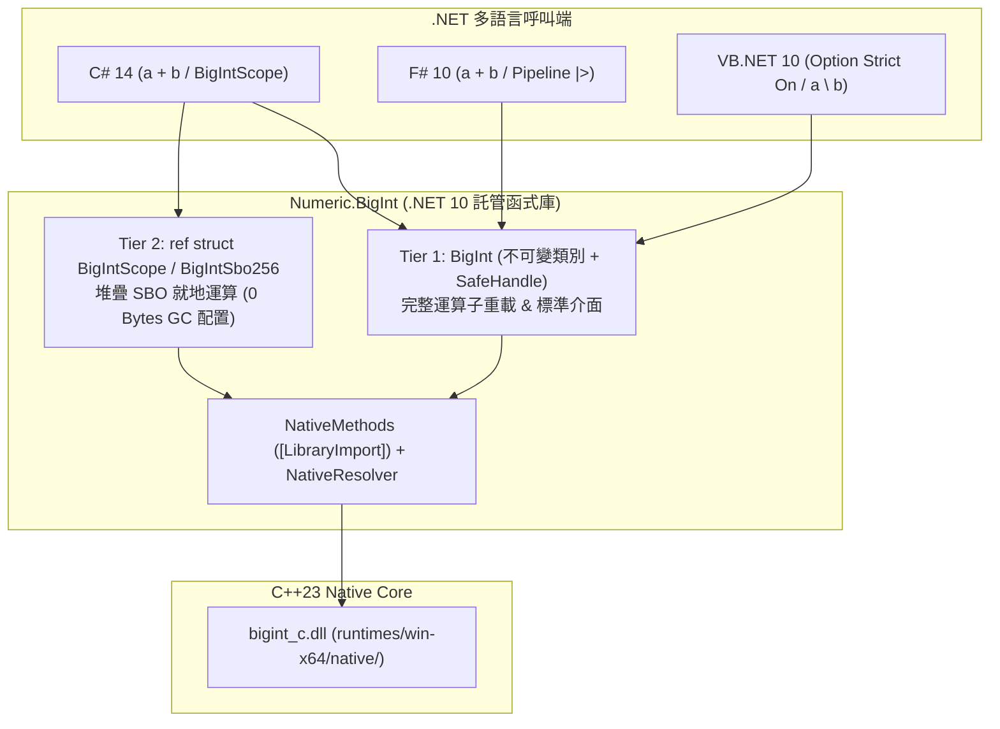

# .NET 跨語言正式封裝函式庫 (`Numeric.BigInt`)

`Numeric.BigInt` 是針對 **.NET 10** 生態系打造的官方跨語言大數運算函式庫，透過 `[LibraryImport]` 零封送開銷 P/Invoke 技術封裝原生的 `bigint_c.dll`（CPP-BigInt C-ABI），作為 `System.Numerics.BigInteger` 的高速、低/零 GC 記憶體替代方案。

本函式庫經過嚴格 CLS 適配與測試，完整支援 **.NET 家族三大語言**：**C# 14**、**F# 10** 與 **VB.NET 10**。

---

## 系統架構設計

`Numeric.BigInt` 採用「安全託管層」與「零 GC 堆疊層」的雙層設計，兼顧開發體驗與極致執行效能：



### 零配置自動原生庫載入 (`NativeResolver`)

`NativeResolver` 於組件初始化時自動透過 `NativeLibrary.SetDllImportResolver` 註冊解析器，依序自動探查以下路徑載入 `bigint_c.dll`（或 Linux `.so` / macOS `.dylib`），使用者無需手動設定環境變數或複製檔案：

1. 應用程式執行目錄（`AppContext.BaseDirectory`）
2. 執行階段識別碼目錄（`runtimes/<rid>/native/`）
3. Windows x64 預設目錄（`runtimes/win-x64/native/`）
4. 專案原始碼開發建置目錄（`build/Release/`）
5. 作業系統預設動態庫搜尋路徑

---

## API 總覽

### Tier 1：`Numeric.BigInt`（通用安全不可變類別）

`BigInt` 語義與 `System.Numerics.BigInteger` 一致，底層由繼承自 `SafeHandleZeroOrMinusOneIsInvalid` 的 `BigIntHandle` 管理原生指標生命週期，確保確定性與 Finalizer 安全釋放。

- **實作介面**：`IComparable<BigInt>`, `IComparable`, `IEquatable<BigInt>`, `IFormattable`, `IParsable<BigInt>`, `ISpanParsable<BigInt>`, `ISpanFormattable`
- **建構與靜態常數**：
  - `BigInt()`、`BigInt(int)`、`BigInt(uint)`、`BigInt(long)`、`BigInt(ulong)`、`BigInt(string, int radix = 10)`、`BigInt(ReadOnlySpan<char>, int radix = 10)`
  - 靜態屬性：`BigInt.Zero`、`BigInt.One`、`BigInt.MinusOne`
  - 隱式轉型：支援由 `byte`、`sbyte`、`short`、`ushort`、`int`、`uint`、`long`、`ulong` 隱式轉為 `BigInt`
  - 顯式轉型：`(int)`、`(uint)`、`(long)`、`(ulong)`、`(double)`
- **屬性檢測**：`Sign`、`IsZero`、`IsOne`、`IsEven`、`BitLength`、`LimbCount`、`IsSbo`
- **運算子重載**：
  - 算術：`+`, `-`, `*`, `/`, `%`, 一元 `-`, `+`, `++`, `--`
  - 位元：`&`, `|`, `^`, `~`, `<<`, `>>`
  - 比較：`==`, `!=`, `<`, `<=`, `>`, `>=`
  - VB.NET 專用整數除法：`op_IntegerDivision`（對應 VB 的 `\` 運算子）
  - 具名靜態方法：`Add`, `Subtract`, `Multiply`, `Divide`, `Modulus`, `Negate`, `BitwiseAnd`, `BitwiseOr`, `Xor`, `OnesComplement`, `LeftShift`, `RightShift`
- **高精度數學函式**：
  - `Pow(baseValue, exponent)`
  - `GreatestCommonDivisor(left, right)` / `Gcd(left, right)`
  - `LeastCommonMultiple(left, right)` / `Lcm(left, right)`
  - `IntegerSquareRoot(value)` / `Sqrt(value)`
  - `DivRem(dividend, divisor, out remainder)`
  - `Abs(value)`, `Min(val1, val2)`, `Max(val1, val2)`, `Compare(left, right)`
- **解析與格式化**：
  - `Parse` / `TryParse`：支援 `string` 與 `ReadOnlySpan<char>`，支援 2 至 36 進位。
  - `ToString(int radix)` / `ToString(string? format, IFormatProvider?)` / `TryFormat`：支援 `D`/`d`（十進位）、`X`/`x`（十六進位大小寫）、`B`/`b`（二進位）、`O`/`o`（八進位）。

---

### Tier 2：零 GC 配置堆疊層 (`BigIntScope` & `BigIntSbo256`)

專為極致低延遲、零垃圾回收（0 Bytes GC Allocation）的熱點迴圈設計（適用於 C#）：

1. **`ref struct BigIntSbo256`**：
   - 嚴格佔用 64 Bytes（與 `bigint_sbo256_t` / 4 limbs 對齊）的堆疊結構，實作 `IDisposable`。
   - 提供靜態就地運算：`Add`, `Subtract`, `Multiply`, `Divide`, `Modulus`, `Compare`, `Sign`, `IsZero` 及 `ToBigInt()`。
2. **`ref struct BigIntScope`**：
   - 堆疊型別暫存池（Arena），預設透過 `NativeMemory.AllocZeroed` 配置 16 個 64-byte SBO 槽位（0 GC 配置），或接收呼叫端以 `stackalloc byte[...]` 傳入的純執行緒堆疊緩衝區。
   - 離開 `using` 區塊時自動批次解構所有槽位，避免手動追蹤多個 `Dispose()` 呼叫。

> [!IMPORTANT]
> **VB.NET 相容性提示**：Roslyn Visual Basic 編譯器不支援直接建立或消費 `ref struct` 型別。VB.NET 開發者應統一使用 Tier 1 的 `BigInt` 類別，在多數情境下仍具備優於原生 `BigInteger` 數倍的運算效能。

---

## 多語言使用範例

### 1. C# 14 (.NET 10)

```csharp
using System;
using Numeric;

// Tier 1: Idiomatic 不可變物件與運算子重載
BigInt a = BigInt.Parse("123456789012345678901234567890");
BigInt b = new(987654321L);
BigInt c = (a + b) * (a - b);
Console.WriteLine($"Hex = {c:X}");

// Tier 2: 零 GC 堆疊 Arena (BigIntScope + stackalloc)
Span<byte> stackBuf = stackalloc byte[512]; // 可容納 8 個 64-byte SBO 槽位
using var scope = new BigIntScope(stackBuf);
IntPtr sa = scope.Create(500L);
IntPtr sb = scope.Create(200L);
IntPtr res = scope.Create();
scope.Multiply(res, sa, sb);
Console.WriteLine($"Stack SBO Result = {scope.ToString(res)}");
```

### 2. F# 10 (.NET 10)

```fsharp
open System
open Numeric

let result =
    BigInt.Parse("100")
    |> fun x -> x + BigInt(50L)
    |> fun x -> x * BigInt(2L)
    |> fun x -> x - BigInt(20L)
    |> fun x -> x / BigInt(4L)

printfn "Pipeline Result = %s" (result.ToString())
```

### 3. VB.NET 10 (`Option Strict On`)

```vb
Option Strict On
Option Explicit On
Option Infer On

Imports System
Imports Numeric

Module Example
    Sub Main()
        Dim a As New BigInt(200L)
        Dim b As New BigInt(30L)

        ' 支援 VB 原生算術、整數除法 (\) 與 Mod
        Dim sum = a + b
        Dim quotient = a \ b
        Dim remainder = a Mod b

        Console.WriteLine($"Sum={sum}, Q={quotient}, R={remainder}")
    End Sub
End Module
```

---

## 建置、測試與 NuGet 打包

解決方案位於 [`dotnet/NumericBigInt.slnx`](../dotnet/NumericBigInt.slnx)，包含核心專案與三個語言的獨立測試專案：

```powershell
# 1. 確保已建置原生 bigint_c.dll 並建置整個 .NET 解決方案
dotnet.exe build dotnet\NumericBigInt.slnx -c Release

# 2. 分別執行 C# 14、F# 10 與 VB.NET 10 測試套件
dotnet.exe run -c Release --project dotnet\tests\Numeric.BigInt.Tests.CSharp\Numeric.BigInt.Tests.CSharp.csproj
dotnet.exe run -c Release --project dotnet\tests\Numeric.BigInt.Tests.FSharp\Numeric.BigInt.Tests.FSharp.fsproj
dotnet.exe run -c Release --project dotnet\tests\Numeric.BigInt.Tests.VB\Numeric.BigInt.Tests.VB.vbproj

# 3. 打包成含原生 win-x64 動態庫的 NuGet 套件 (Numeric.BigInt.1.0.0.nupkg)
dotnet.exe pack dotnet\src\Numeric.BigInt\Numeric.BigInt.csproj -c Release -o dotnet\artifacts
```
